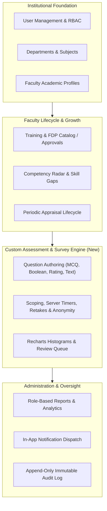

# AcademiaSync — Faculty Enhancement & Performance Management Platform

AcademiaSync is an enterprise-grade full-stack faculty enhancement, competency development, appraisal review, and ad-hoc assessment platform built for universities and higher education institutions. It unifies academic profiles, training and FDP workflows, skill gap monitoring, formal performance reviews, institutional surveys, analytics, notifications, and append-only audit logging in a role-aware system.

---

## 🏛 Platform Architecture & Core Modules



---

## ✨ Features & Capabilities

### 1. Faculty Profiles & Academic Dossiers
- Comprehensive academic profiles including educational qualifications, industrial/teaching experience, professional certifications, research publications, awards, and subjects taught.
- Real-time profile completeness calculator and administrative verification status.

### 2. Training Programs, FDPs & LMS Integration
- Institutional catalog for Faculty Development Programs (FDPs), workshops, conferences, seminars, and MOOCs.
- Multi-tier nomination and approval workflows (Faculty self-nomination → HOD approval → HR/Admin oversight).
- Attendance, completion tracking, certificate URL attachment, and participant feedback.

### 3. Competency Radar & Skill Gap Analysis
- Multi-source competency evaluations (Self, HOD, Peer, and Assessment Benchmarks).
- Interactive Recharts Spider/Radar visualization comparing current faculty index against institutional milestones.
- Departmental skill gap identification with targeted training recommendation suggestions.

### 4. Periodic Appraisal Reviews & Rubrics
- Academic year appraisal cycle configuration with customizable criteria, weightages, and scoring rubrics.
- Two-stage evaluation workflow: Faculty Self-Assessment submission followed by HOD/Dean review and scoring.

### 5. Custom Assessment & Institutional Survey Engine *(New)*
- **Ad-Hoc Diagnostic & Survey Authoring**: HODs, Deans, and Administrators can create customized question sets on any topic (pedagogical methods, AI ethics, curriculum readiness, lab facilities, research integrity).
- **Flexible Question Types**:
  - *Multiple Choice Questions (MCQ)*: Single-choice options with automatic scoring.
  - *True / False (Boolean)*: Binary evaluation with automatic scoring.
  - *1–5 Rating Scale*: Likert scale for feedback and satisfaction surveys.
  - *Open-Ended Free Text*: Descriptive submissions with reviewer grading rubrics and manual annotation capabilities.
- **Granular Scoping**: Target assessments campus-wide, to specific departments (with HOD department boundary enforcement), by role, or to specific faculty members.
- **Server-Side Timers & Auto-Submit**: Configurable duration limits with live frontend countdowns and backend timestamp verification to prevent timing bypasses.
- **Dual-Layer Anonymity Protection**: Retains submission integrity in storage to enforce single-attempt rules, while strictly masking faculty identity and randomizing order at all read/export endpoints when `isAnonymous: true`.
- **Competency Benchmark Integration**: Graded assessment scores linked to competencies automatically record weighted diagnostic entries in `CompetencyRecord.assessments`.
- **Accreditation Export**: One-click CSV export of raw and aggregate results for institutional reporting and accreditation audits.
- **Reusable Templates**: Save standardized question sets as templates for reuse across semesters.

### 6. Notifications & System Compliance
- Automated in-app notifications on assessment publication, deadline reminders, training approvals, and reviewer evaluations.
- Background compliance monitoring jobs for overdue submissions and cycle expirations.

### 7. Append-Only Immutable Audit Logging
- Comprehensive event tracking for user actions (`create`, `update`, `delete`, `login`, `logout`, `export`).
- Schema-level mutation blocks preventing modification or deletion of existing audit records.

---

## 👥 Role-Based Access Control (RBAC) Matrix

| Module / Action | Faculty | HOD | Dean | HR Manager | Administrator |
|---|:---:|:---:|:---:|:---:|:---:|
| **View / Edit Own Profile** | ✅ | ✅ | ✅ | ✅ | ✅ |
| **Manage Departments & Users** | ❌ | ❌ | ❌ | ❌ | ✅ |
| **Nominate / Enroll in Training** | ✅ | ✅ | ✅ | ❌ | ✅ |
| **Approve Training Nominations** | ❌ | ✅ (Dept) | ✅ (All) | ❌ | ✅ (All) |
| **View Competency Radar** | ✅ (Own) | ✅ (Dept) | ✅ (All) | ❌ | ✅ (All) |
| **Submit Self-Appraisal** | ✅ | ✅ | ❌ | ❌ | ❌ |
| **Review & Score Appraisals** | ❌ | ✅ (Dept) | ✅ (All) | ❌ | ✅ (All) |
| **Create Assessment / Survey** | ❌ | ✅ (Dept) | ✅ (All) | ❌ | ✅ (All) |
| **Take Assigned Assessment** | ✅ | ✅ (If targeted) | ✅ (If targeted) | ❌ | ❌ |
| **View Assessment Analytics & Grade** | ❌ | ✅ (Dept) | ✅ (All) | ✅ (Reports) | ✅ (All) |
| **Export Results / Audit Logs** | ❌ | ✅ (CSV) | ✅ (CSV) | ✅ (Reports) | ✅ (Full Audit) |

---

## 🛠 Tech Stack

### Backend
- **Runtime**: Node.js (v18+) & TypeScript
- **Framework**: Express 5
- **Database**: MongoDB with Mongoose ODM
- **Authentication**: JSON Web Tokens (JWT) & bcryptjs
- **Security & Headers**: Helmet, CORS origin validation, Morgan HTTP logging
- **Validation**: Zod schema validation & Mongoose model guards
- **Audit Logging**: Append-only immutable collection

### Frontend
- **Framework**: React 19 with TypeScript
- **Bundler & Tooling**: Vite 8 & Tailwind CSS v4
- **Routing**: React Router 7
- **Data Visualization**: Recharts (Histograms, Radar Charts, Bar Charts)
- **Icons & UI**: Lucide React & Modular Glassmorphism UI Components
- **HTTP Client**: Axios with centralized interceptors and bearer token injection

---

## 📁 Repository Structure

```text
faculty_enhancement/
├── backend/
│   ├── src/
│   │   ├── config/             # Database connection & env config
│   │   ├── controllers/        # Express request handlers & business logic
│   │   │   ├── appraisalController.ts
│   │   │   ├── assessmentController.ts   # Custom Assessment & Survey Engine
│   │   │   ├── auditController.ts
│   │   │   ├── authController.ts
│   │   │   ├── competencyController.ts
│   │   │   ├── departmentController.ts
│   │   │   ├── notificationController.ts
│   │   │   ├── profileController.ts
│   │   │   ├── reportController.ts
│   │   │   ├── trainingController.ts
│   │   │   └── userController.ts
│   │   ├── jobs/               # Background compliance & reminder schedulers
│   │   ├── middlewares/        # JWT auth, RBAC guards, and centralized errorHandler
│   │   ├── models/             # Mongoose schemas (Assessment, Appraisal, User, etc.)
│   │   ├── routes/             # RESTful API route definitions
│   │   ├── seed/               # Demo database seeder script
│   │   ├── services/           # Audit logging & reusable domain services
│   │   └── index.ts            # Server entry point & route mounting
│   ├── .env.example
│   ├── package.json
│   └── tsconfig.json
├── frontend/
│   └── my-app/
│       ├── src/
│       │   ├── api/            # Typed Axios API clients (assessments, auth, etc.)
│       │   ├── components/     # UI primitives (Cards, Modals, Badges, Tabs) & Layout
│       │   ├── context/        # Global AuthContext & session state
│       │   ├── pages/          # Application views by feature
│       │   │   ├── admin/      # User management & Audit log viewers
│       │   │   ├── appraisal/  # Performance review & self-assessment
│       │   │   ├── assessments/# Assessment List, Builder Modal, Taking, & Analytics
│       │   │   ├── competency/ # Radar charts & gap analysis
│       │   │   ├── dashboard/  # Role-tailored dashboards
│       │   │   ├── profile/    # Academic profile & dossier editor
│       │   │   ├── public/     # Campus website & public directory
│       │   │   ├── reports/    # Institutional reports
│       │   │   └── training/   # FDP catalog & approvals
│       │   ├── types/          # Shared TypeScript interfaces
│       │   ├── utils/          # Navigation sections, status colors, constants
│       │   ├── App.tsx         # Route configuration
│       │   └── main.tsx
│       ├── package.json
│       ├── vite.config.ts
│       └── tsconfig.json
├── README.md
├── render.yaml
└── .gitignore
```

---

## 🚀 Getting Started

### Prerequisites
- **Node.js**: v18.0.0 or higher
- **npm**: v9.0.0 or higher
- **MongoDB**: Local MongoDB instance (`mongodb://localhost:27017/academiasync`) or MongoDB Atlas cluster connection.

---

### 1. Backend Setup

```bash
cd backend

# Install dependencies
npm install

# Configure environment variables
cp .env.example .env
```

Edit `backend/.env` with your database credentials and secret keys:

```env
PORT=5000
MONGODB_ATLAS_URI=mongodb://localhost:27017/academiasync
JWT_SECRET=super_secret_jwt_key_change_in_production
JWT_EXPIRES_IN=7d
NODE_ENV=development
CORS_ORIGIN=http://localhost:5173,http://localhost:3000
```

---

### 2. Frontend Setup

```bash
cd ../frontend/my-app

# Install dependencies
npm install
```

*(Optional)* Configure `frontend/my-app/.env` if running on custom ports:

```env
VITE_API_URL=http://localhost:5000/api/v1
```

---

### 3. Seed Demo Data

Populate the database with departments, faculty accounts, training programs, appraisal cycles, competency records, and sample assessments:

```bash
cd backend
npm run seed
```

---

### 4. Run the Application

#### Start the Backend API
```bash
cd backend
npm run dev
```
- API Health: `http://localhost:5000/health`
- Base API: `http://localhost:5000/api/v1`

#### Start the Frontend App
```bash
cd frontend/my-app
npm run dev
```
- Web Application: `http://localhost:5173`

---

## 🔑 Demo Accounts for Role Testing

All accounts are pre-seeded with standardized credentials for evaluation:

| Role | Email | Password | Primary Permissions |
|---|---|---|---|
| **Administrator** | `admin@academiasync.edu` | `Admin@123` | Full system control, User management, Audit logs, Global Assessments |
| **Head of Department (CSE)** | `hod.cse@academiasync.edu` | `Hod@123` | Dept. training approvals, Dept. appraisals, Dept. assessments & grading |
| **Dean** | `dean@academiasync.edu` | `Dean@123` | Institution-wide oversight, Competency analytics, Campus surveys |
| **HR Manager** | `hr@academiasync.edu` | `Hr@123` | Institutional reports, Compliance monitoring, Training metrics |
| **Faculty Member (CSE)** | `faculty@academiasync.edu` | `Faculty@123` | Profile management, Training enrollment, Self-appraisal, Take assessments |
| **Faculty Member (ECE)** | `faculty2@academiasync.edu` | `Faculty@123` | Profile management, Training enrollment, Self-appraisal, Take assessments |

---

## 📡 REST API Reference (`/api/v1`)

### Authentication & Users
- `POST /api/v1/auth/login` — Authenticate and receive JWT
- `GET  /api/v1/auth/me` — Retrieve current authenticated user profile
- `POST /api/v1/auth/refresh` — Refresh access token
- `GET  /api/v1/users` — List institutional users (Admin only)
- `POST /api/v1/users` — Create user account (Admin only)

### Custom Assessment & Survey Engine
- `GET    /api/v1/assessments` — List assessments (role-scoped query filters)
- `POST   /api/v1/assessments` — Create custom assessment or survey (HOD / Dean / Admin)
- `GET    /api/v1/assessments/:id` — Get assessment details (masks correct answers during live attempts)
- `PATCH  /api/v1/assessments/:id` — Edit assessment (Draft mode only)
- `DELETE /api/v1/assessments/:id` — Delete assessment (Draft mode without submissions)
- `POST   /api/v1/assessments/:id/publish` — Publish assessment & dispatch targeted notifications
- `POST   /api/v1/assessments/:id/close` — Close assessment for new submissions
- `POST   /api/v1/assessments/:id/start` — Start attempt session & initialize server timer
- `POST   /api/v1/assessments/:id/responses` — Submit answers with auto-grading & server timeout validation
- `GET    /api/v1/assessments/:id/responses` — View aggregate cohort responses & Recharts analytics
- `GET    /api/v1/assessments/:id/responses/:facultyId` — View individual response details
- `PATCH  /api/v1/assessments/:id/responses/:facultyId/grade` — Manually grade text answers & add evaluator feedback
- `GET    /api/v1/assessments/:id/export` — Export cohort results in CSV format

### Training & LMS
- `GET  /api/v1/training/programs` — List available training programs
- `POST /api/v1/training/programs` — Create new training program (Admin)
- `POST /api/v1/training/enrollments` — Self-nominate for training program
- `PUT  /api/v1/training/enrollments/:id/approve` — Approve nomination (HOD / Dean)
- `PUT  /api/v1/training/enrollments/:id/complete` — Mark completion & upload certificate

### Competency & Skill Radar
- `GET /api/v1/competency/skill-areas` — List skill taxonomy
- `GET /api/v1/competency/me` — Get authenticated faculty competency profile
- `GET /api/v1/competency/gap-analysis/:deptId` — Departmental gap analysis & radar metrics

### Performance Appraisals
- `GET  /api/v1/appraisals/cycles` — List appraisal cycles
- `GET  /api/v1/appraisals/mine` — Get current faculty appraisal dossiers
- `POST /api/v1/appraisals/self-assessment` — Submit faculty self-assessment
- `PUT  /api/v1/appraisals/:id/reviewer-assessment` — Submit HOD / Dean review and final score

### Notifications, Reports & Audit
- `GET /api/v1/notifications/mine` — Fetch active in-app notifications
- `PUT /api/v1/notifications/:id/read` — Mark notification as read
- `GET /api/v1/reports/summary` — Comprehensive institutional KPI analytics
- `GET /api/v1/audit` — View append-only audit trail (Administrator only)

---

## 🔒 Security & Data Integrity Highlights

1. **Credential Hygiene**: Sensitive credentials (e.g. database connection strings and `.env` files) are strictly excluded from git tracking via `.gitignore`.
2. **Append-Only Audit Log**: `AuditLog` collection enforces mutation blocks at the Mongoose middleware level against `updateOne`, `updateMany`, `findOneAndUpdate`, `deleteOne`, and `deleteMany`.
3. **Read-Layer Anonymity**: For anonymous surveys, faculty IDs are preserved internally solely to prevent duplicate submissions, while the read serialization layer dynamically redacts identities into pseudonyms (e.g., *Anonymous Respondent #1*) and randomizes response ordering.
4. **Server-Side Timer Verification**: In timed assessments, submission timestamps are validated against `startedAt` on the backend (`timeLimitMinutes * 60 + gracePeriod`), ensuring frontend timer tampering cannot bypass testing windows.
5. **Safe Competency Linkages**: Assessment benchmark scores feed into `CompetencyRecord.assessments` as dated diagnostic entries without destructively overwriting formal manager calibrations.

---

## 🧪 Build & Verification

Verify the entire monorepo builds cleanly with zero TypeScript errors:

```bash
# 1. Verify Backend Compilation
cd backend
npm run build

# 2. Verify Frontend Compilation & Asset Bundling
cd ../frontend/my-app
npm run build
```

---

## 📄 License

This software is developed for academic institutions and faculty performance enhancement workflows. Distributed under the ISC License.
